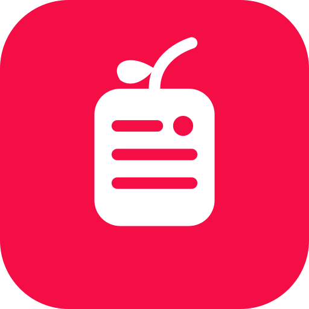
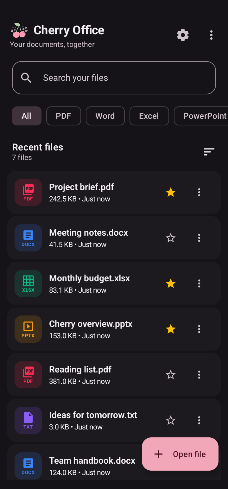
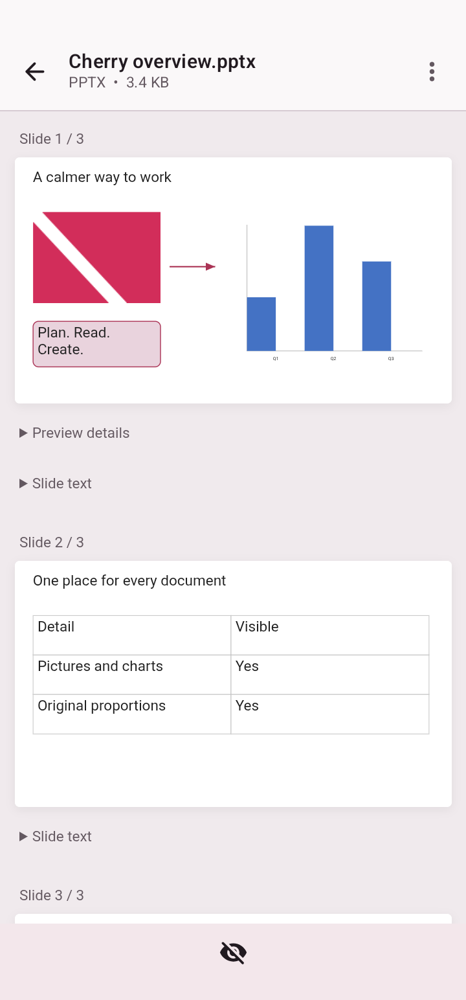
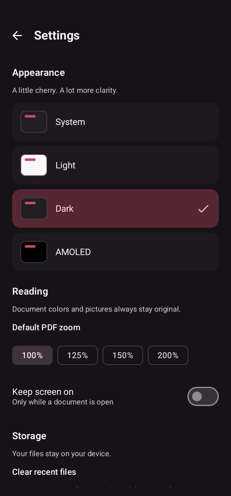

<div align="center">
  
  <h1>Cherry Office</h1>
  <p><strong>A little cherry. More room for your documents.</strong></p>
  <p>An offline document reader for Android.<br />PDFs, documents, spreadsheets, and slides — together in one quiet space.</p>
  <p>
    
    
    
  </p>
  <p>
    <a href="https://github.com/asta-JC/Cherry-Office/releases/download/v1.2/Cherry-Office_v1.2.apk"><strong>Download APK · v1.2</strong></a> ·
    <a href="https://github.com/asta-JC/Cherry-Office/releases/tag/v1.2">Release notes</a>
  </p>
  <p>
    <a href="#screenshots">Screenshots</a> ·
    <a href="#features">Features</a> ·
    <a href="#getting-started">Get started</a> ·
    <a href="https://github.com/asta-JC/Cherry-Office/issues">Feedback</a>
  </p>
</div>

---

## Overview

Cherry Office keeps everyday reading on your device. Open a file from your storage or another app, find it again in your recent files, and read with a light, dark, or AMOLED interface. The original Cherry Office icon and small cherry accents give it a place in the CherryApp family.

## Screenshots

<table>
  <tr>
    <th width="33%">Your library</th>
    <th width="33%">Slides, with their details</th>
    <th width="33%">Make it yours</th>
  </tr>
  <tr>
    <td align="center"></td>
    <td align="center"></td>
    <td align="center"></td>
  </tr>
  <tr>
    <td align="center">Find, filter, and favorite.</td>
    <td align="center">Scroll vertically. Pinch for a closer look.</td>
    <td align="center">Choose how you like to read.</td>
  </tr>
</table>

Captured on a physical Samsung Galaxy S22 Ultra using the app's production screens. Library filenames and slide content are demonstration data; no personal documents are shown.

## Features

- **One library:** recent files, search, type filters, favorites, folder browsing, and sharing.
- **PDF reading:** continuous vertical pages, pinch zoom, page navigation, and embedded-text selection with adjustable handles.
- **Word documents:** styled text, tables, pictures, lists, and page layouts from modern Office files.
- **Spreadsheets:** multiple sheets, number and date formats, saved formula results, cell styles, search, and copying.
- **Visual slides:** positioned text, pictures, common shapes, lines, tables, and basic charts, with automatic text fitting.
- **Personal reading:** System, Light, Dark, and AMOLED appearances, saved PDF zoom, and a keep-screen-on option while reading.

## Supported formats

| Format | What you can read |
| :--- | :--- |
| PDF | `.pdf` — pages, pictures, and embedded text |
| Word | `.docx`, `.docm`, `.dotx` — modern Word documents |
| Excel | `.xls`, `.xlsx`, `.xlsm`, `.xltx` — sheets and saved cell values |
| PowerPoint | `.pptx`, `.pptm`, `.potx` — static visual slide previews |
| Tables | `.csv`, `.tsv` — a grid with quoted and multiline fields |
| Text | `.txt`, `.md`, `.log`, `.json`, `.xml`, `.yaml`, `.yml` |
| Pictures | Image formats supported by the device's decoder |

**Preview limits:** Office layouts can differ from the authoring app. PowerPoint animations are static; some diagrams, custom shapes, and advanced chart styling need another office app. Spreadsheet previews show up to 10,000 populated rows and 256 columns per sheet, use saved formula results, and do not recalculate formulas. Scanned PDFs need OCR for text selection; OCR is not included. Older `.doc` / `.ppt` and OpenDocument files use an external-app handoff.

## Getting started

### Download

Install [Cherry-Office_v1.2.apk](https://github.com/asta-JC/Cherry-Office/releases/download/v1.2/Cherry-Office_v1.2.apk) from [GitHub Releases](https://github.com/asta-JC/Cherry-Office/releases/tag/v1.2). The release includes a SHA-256 checksum file.

This APK is the debug/test-signed build verified on a physical device. It uses the current development certificate, rather than a separate production signing key.

### Requirements

- Android 7.0 / API 24 or newer on a physical device.
- Android Studio compatible with the project's pinned Gradle and Android Gradle Plugin versions.
- Android SDK 37. The local build has been verified with JDK 25; the project targets Java 11 bytecode.

### Build and run

```bash
git clone https://github.com/asta-JC/Cherry-Office.git
cd Cherry-Office
./gradlew :app:assembleDebug --max-workers=1
```

The debug APK is generated at `app/build/outputs/apk/debug/app-debug.apk`. Connect your physical Android device and run from Android Studio, or install it with:

```bash
adb -s YOUR_DEVICE_SERIAL install -r app/build/outputs/apk/debug/app-debug.apk
```

### Tests

```bash
./gradlew :app:testDebugUnitTest --max-workers=1
```

Device tests and README screenshots run on a physical device. See [the screenshot capture notes](docs/screenshots/README.md) for the reproducible gallery workflow.

## Built with

| Layer | Technology |
| :--- | :--- |
| Interface | Kotlin, Jetpack Compose, Material 3 |
| Navigation | Navigation 3 |
| PDF | Android `PdfRenderer` and PDFBox Android for embedded text |
| Office documents | Local OOXML readers, SVG/HTML, Android WebView |
| Legacy Excel | Apache POI HSSF through [`office-compat`](office-compat/README.md) |
| Local data | Room and DataStore |
| App structure | Hilt, ViewModels, coroutines, and StateFlow |

<details>
<summary>Source map</summary>

```text
app/src/main/java/com/asta/cherryoffice/
├── data/          # Document history, preferences, and repositories
├── docx/          # Word-to-HTML reader
├── excel/         # Spreadsheet readers and grid rendering
├── formats/       # Bounded Office archives and slide graphics
├── pdf/           # PDF sessions, text selection, and reading surface
├── ui/            # Library, settings, viewers, components, and theme
└── utils/         # File metadata, types, and URI helpers
```

</details>

## What's new in 1.2

- A short, silent CherryApp Family launch animation with a Skip button.
- Original 720p video frames at normal speed, displayed without zooming or cropping.
- Direct document opening and warm returns skip the intro.
- Automatic playback cleanup keeps the decoder from running after launch.


## Feedback

Found a file that does not display correctly? [Open an issue](https://github.com/asta-JC/Cherry-Office/issues) with its format, device model, and steps to reproduce. Use a small, non-sensitive sample when possible.

## License & credits

Cherry Office is part of Asta's project series. The existing project notice permits personal and educational use; this repository does not currently include a standalone license file. Third-party libraries keep their own licenses and notices, bundled in [`app/src/main/assets/third_party`](app/src/main/assets/third_party).

---

<p align="center">
  <strong>Made with ❤️ &amp; 🍒 by Asta</strong><br />
  <sub>Part of the CherryApp family.</sub>
</p>
